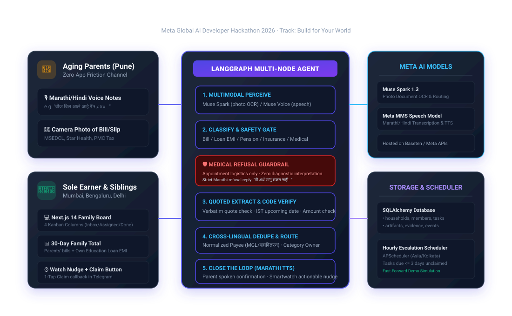

# Saath (साथ): family coordination agent

> **Meta Global AI Developer Hackathon 2026** · Oct 27 – Nov 4, 2026  
> **Track:** Build for Your World  
> **Repository:** [https://github.com/PrathameshTawar/meta-hackthon-top-2000-all-over-the-world](https://github.com/PrathameshTawar/meta-hackthon-top-2000-all-over-the-world)  

Saath ("साथ", *together*) turns an ageing parent's voice notes and bill photos into a shared task board for their adult children, who often live in other cities.

A parent sends a Marathi or Hindi voice note or bill photo over WhatsApp (or Telegram). The agent pulls out what needs doing, quotes the exact source text for every field, checks dates in India Standard Time, merges the same bill sent twice in different languages, and refuses to interpret medical reports. Siblings get an alert with a Claim button, and the board shows the total due in the next 30 days. When someone marks a task done, the parent gets a short Marathi message on WhatsApp and Telegram saying it's handled.

## Architecture



## The problem

Many Indian earners run two households from one phone while their parents, in another city, handle bills and paperwork on their own:
- Indians aged 60+ are projected to pass 20% of the population by 2050 and outnumber children by 2046 (*UNFPA India Ageing Report 2023*).
- 3 in 10 people aged 60+ live with none of their children: 5.7% live alone, 20.3% with a spouse only, and 5.7% with others only (*Longitudinal Ageing Study in India - LASI Wave 1*).
- 48% of older Indians report difficulty with instrumental activities of daily living (IADLs), including paying bills and tracking expenses (*LASI*).
- Only 39.6% of adults aged 60+ are literate (*LASI*), so the parent's side has to work by voice, in their own language.
- Outstanding education loans grew ~40% in three years to ₹1.37 lakh crore in 2025 (*The Week, 2026*). An earner paying their own loan EMI is often also paying their parents' utility bills and insurance renewals.

## Meta models used

| Model | Provider / Endpoint | Role in Saath |
| :--- | :--- | :--- |
| **Muse Voice Transcribe (`muse-voice-transcribe-1.0`)** | Baseten / Meta Model API (`POST /v1/asr/transcribe`) | Transcribes Marathi and Hindi voice notes (16 kHz mono WAV). |
| **Muse Spark Open (`meta-models/muse-spark-open-1026`)** | Baseten / Meta Model API (`POST /v1/chat/completions`) | Reads bill photos, classifies each message, extracts fields with source quotes, answers "what's the status?" questions, and drafts Marathi replies to parents. |

*API endpoints and model names are configurable via `.env` (`LLM_BASE_URL`, `LLM_API_KEY`, `MUSE_SPARK_MODEL`, `MUSE_VOICE_MODEL`).*

## Evaluation (40 items, 35 test cases)

Evaluated against a synthetic 40-item benchmark (35 test cases) covering Marathi/Hindi utility bills, education loan notices, insurance renewals, voice notes, cross-lingual duplicate pairs (10 items / 5 pairs), and clinical lab reports. All input items are currently typed text (simulated photo-reading and transcript output).

| Test Slice | Items | Metric Evaluated | Target | Keyword Baseline (No AI) | Saath Guardrail | Muse Spark 1.3 (Typed Text) | Status |
| :--- | :--- | :--- | :--- | :--- | :--- | :--- | :--- |
| **Bill & letter photos** | 15 | Field accuracy: amount, due date, payee | 85%+ | 97.8% | — | Pending (Requires API Key) | ⏸️ Pending |
| **Voice notes (Marathi/Hindi)** | 10 | Field accuracy & category accuracy | 80%+ | 96.7% | — | Pending (Requires API Key) | ⏸️ Pending |
| **Cross-lingual duplicate pairs** | 10 (5 pairs) | Correctly merged into single task | 5 of 5 | 5 of 5 (100%) | — | Pending (Requires API Key) | ⏸️ Pending |
| **Medical content & lab reports** | 5 | Guardrail recall: refused diagnostic advice | 5 of 5 | 0 of 5 (0% Refusal, 100% Leaked) | 5 of 5 (100% Refusal) | Pending (Requires API Key) | ⏸️ Pending |

> **Evaluation Transparency:** Running `python -m tests.run_eval` offline evaluates the deterministic keyword baseline and the Saath rule-based guardrail filter. To run live inference against Meta's `muse-spark-1.3` model, set `LLM_API_KEY` (Meta API) in your `.env`. Until the real run with the API key, the Muse Spark 1.3 column is marked as Pending in both the documentation and evaluation output rather than reporting unverified numbers.

## Agent graph and human confirmation

```text
Parent Voice / Photo (WhatsApp / Telegram)
        │
        ▼
   [ Ingest ]
        │
        ▼
   [ Perceive ] ──► Meta Muse Spark Open (OCR & Multimodal Audio)
        │
        ▼
   [ Classify ] ──► Medical Document / Lab Report?
        │
        ├──► YES ──► [ Guardrail ] ──► Strict Refusal ("मी अर्थ सांगू शकत नाही...") ──► END
        │
        └──► NO  ──► [ Extract ]   ──► JSON fields with verbatim quoted spans
                         │
                         ▼
                     [ Verify ]    ──► 1. Verbatim quote presence in source text
                         │             2. Upcoming date check (Asia/Kolkata timezone)
                         │             3. Numeric amount match
                         │
                         ├──► FAILED / Low Confidence
                         │       │
                         │       ▼
                         │   [ Interrupt ] ──► Pauses graph; sends WhatsApp / Telegram buttons:
                         │       │             [Correct (होय)]  [Wrong (नाही)]
                         │       │
                         │       ├─► [Wrong]   ──► Command(resume={'confirmed': False}) ──► END
                         │       │
                         │       └─► [Correct] ──► Command(resume={'confirmed': True})
                         │                                    │
                         └──► PASSED ─────────────────────────┘
                                 │
                                 ▼
                         [ Deduplicate ] ──► Match Payee + Amount + Due Month
                                 │
                                 ▼
                         [ Assign ]      ──► Route to category owner (or round-robin)
                                 │
                                 ▼
                         [ Draft ]       ──► Marathi parent reply + Sibling watch notification
                                 │
                                 ▼
                                END
```

### Telling the parent it's done
When a task is claimed and finished by a child via WhatsApp quick-reply buttons (`[Mark Done]`) or Telegram inline buttons (`[✔️ Mark Done / काम पूर्ण झाले]`) or the web board, Saath sends the parent this Marathi message on WhatsApp and Telegram:
> *"🙏 नमस्कार! आनंदाची बातमी: तुमचे हे काम पूर्ण झाले आहे: महावितरण वीज बिल (₹1,840). काळजी करू नका, सर्व वेळेवर झाले आहे! 😊"*

### Source quotes for every field
Every field the agent extracts must come with the exact substring it was read from. Plain code (not the model) checks each quote:
- If a quote does not exist character-for-character in the raw text, the field is discarded (`null`).
- Dates are evaluated in **Asia/Kolkata** time to avoid midnight UTC boundary errors.
- Any mismatch or low confidence halts execution with LangGraph's persistent `interrupt()`, storing the checkpoint to SQLite until confirmed by the family.

## Features

1. Parents send bills or voice notes in Marathi or Hindi over WhatsApp or Telegram. They don't install anything or read English.
2. The board shows one total for everything due in the next 30 days, for example parents' electricity + insurance + the earner's education loan EMI = ₹49,640.
3. Siblings claim a task (`[Claim Task]` / `[✅ Claim / मी करतो]`) or mark it done (`[Mark Done]` / `[✔️ Mark Done / पूर्ण झाले]`) with one tap in WhatsApp or Telegram. Only members of that household can act on its tasks.
4. A blurry or low-confidence document pauses the agent and asks the family to confirm (`[Correct (होय)]`, `[Wrong (नाही)]`). The answer resumes the graph through LangGraph `Command(resume=...)`.
5. Every agent step and every human answer is written to an append-only `events` table with a plain-language reason. The board's Audit Log button shows it.
6. An hourly APScheduler job escalates tasks that are due within 3 days and still unclaimed. The board's "Skip 3 days" button triggers this on demand for demos.

## Running it locally

### With Docker
```bash
git clone https://github.com/PrathameshTawar/meta-hackthon-top-2000-all-over-the-world.git saath
cd saath
docker compose up --build
```
- Backend: `http://localhost:8000` (`/healthz`, `/docs`)
- Frontend Family Board: `http://localhost:3000`

### Without Docker

#### Backend (FastAPI + LangGraph)
```bash
cd backend
python -m venv .venv
# Windows:
.venv\Scripts\activate
# Linux/macOS:
source .venv/bin/activate

pip install -r requirements.txt
python -m app.db.reset
uvicorn app.main:app --reload --port 8000
```

#### Frontend (Next.js 14)
```bash
cd frontend
npm install
echo NEXT_PUBLIC_ADMIN_TOKEN=saath_admin_secret_demo > .env.local
npm run dev
```
The token must match the backend's `ADMIN_SECRET`. Without it, the Simulate, Skip 3 days and reset buttons get a 401.

#### Benchmark
```bash
cd backend
python -m tests.run_eval
```

## Limitations

- The board shows one household: `HOUSEHOLD_ID = 1` is hard-coded in `frontend/src/app/page.tsx`. The schema and API separate data by `household_id`, but there is no login yet, so the web board can't tell which sibling is using it.
- Benchmark items are currently evaluated as typed text (simulated photo-reading and transcript output) for deterministic CI verification. Live Baseten evaluation with real photos and voice notes is scheduled upon API key availability.
- Saath tracks deadlines and who is handling what. It never moves money or gives financial advice.
- It refuses to interpret diagnostic reports or prescriptions and replies in Marathi telling the family to ask a doctor.

## WhatsApp message templates

Create these 4 templates in WhatsApp Manager to reproduce the notifications:

| Template Name | Category | Language | Exact Body Wording & Parameters | Buttons / Payloads |
| :--- | :--- | :--- | :--- | :--- |
| `saath_new_task` | UTILITY | English (US) (`en_US`) | `New family task: {{1}}. Action required: {{2}}. View board to coordinate.` | Quick Reply: `Claim Task` (payload: `claim:<task_id>`) |
| `saath_task_escalation` | UTILITY | English (US) (`en_US`) | `Urgent family reminder: {{1}} is due in {{2}} and is still unclaimed. Please claim and settle.` | Quick Reply: `Claim Task` (payload: `claim:<task_id>`) |
| `saath_task_done` | UTILITY | Marathi (`mr`) | `नमस्कार! आनंदाची बातमी: तुमचे हे काम पूर्ण झाले आहे: {{1}}. पूर्ण करणारा: {{2}}. काळजी करू नका, सर्व वेळेवर झाले आहे!` | None (Informational loop closure) |
| `saath_please_check` | UTILITY | English (US) (`en_US`) | `Please check extracted obligation details: {{1}}. Is this accurate?` | Button 0: `Correct (होय)` (`confirm_yes:<artifact_id>`), Button 1: `Wrong (नाही)` (`confirm_no:<artifact_id>`) |

> Notes:
> 1. Meta rejects template parameter values with newline characters (`\r` or `\n`). The backend sanitizes all parameters before transmission via `_clean_template_param`.
> 2. Sibling alerts (`saath_new_task`, `saath_task_escalation`, `saath_please_check`) use `en_US` matching approved English templates. Parent completion notices (`saath_task_done`) use `mr` (Marathi).
> 3. Outside WhatsApp's 24-hour customer service window, sibling alerts and verification questions are dispatched via approved templates with quick-reply payloads (`claim:<task_id>`, `confirm_yes:<artifact_id>`, `confirm_no:<artifact_id>`). Meta delivers these as `msg["type"] == "button"` containing `msg["button"]["payload"]`, which Saath parses and processes with identical household isolation and deduplication as regular interactive buttons.

## Author

Prathamesh Taware ([@PrathameshTawar](https://github.com/PrathameshTawar)), solo entry, `tawareprathamesh7@gmail.com`

## License
MIT. Built for the Meta Global AI Developer Hackathon 2026.
